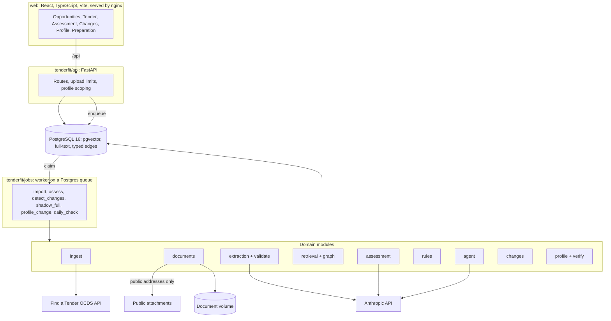
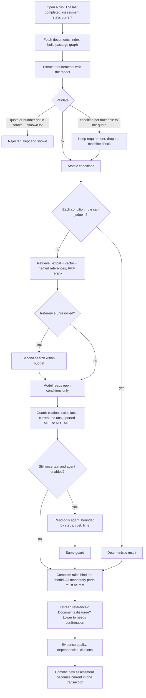
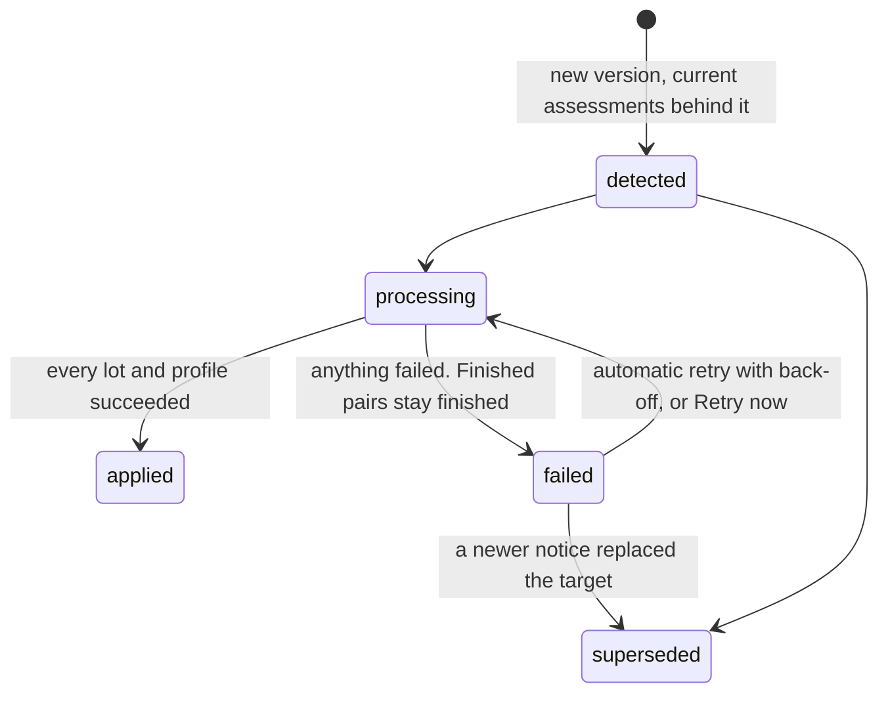
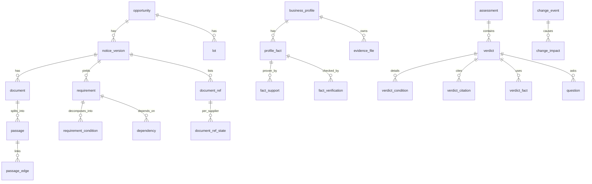

# Architecture

## Components

There is one database. The graph is a table in it, not a separate service: every edge is one hop within one notice version, which needs no graph engine.

## Assessment pipeline

### Verdict policy

| Verdict | Requires |
|---|---|
| **Met** | Every mandatory condition satisfied by a current, compatible fact. Proof where the buyer asks for it |
| **Not met** | An explicit, current, relevant fact contradicts it. A contract list omitting something is not contradiction |
| **Needs confirmation** | Support exists but must be confirmed, or the facts or the documents disagree |
| **Unknown** | Nothing in the profile or documents settles it |

Evidence quality (`strong`, `weak`, `contradictory`, `missing`, `ambiguous`) is a reason, not a probability. No confidence percentage is shown, because none is calibrated.

## Amendment processing

Requirement preparation for a version pair is one transaction ending in a durable marker, so a failed extraction leaves nothing to clean up. Each impact is written in the same transaction as the assessment it describes. Only one process applies amendments at a time, through an advisory lock.

Dependencies are recorded per verdict: what extraction found (source, references, definitions, parameters) and what the verdict used (facts, rule parameters, passages read, the deadline where a dated fact is involved). A plan for one assessment reads only its own verdicts' edges. Structural or ambiguous changes reassess everything.

## Data model

Migrations are numbered SQL files applied in order: 001 to 016.

**Identity:** `tenderfit/auth` holds accounts (Argon2id), sessions (random tokens stored only as SHA-256) and membership. `tenderfit/api/deps.py` derives the user and active supplier for each request and re-checks membership each time; no route takes a supplier or user from the client. Another supplier's resource returns 404. State-changing requests need an `X-TenderFit` header, which a cross-site form cannot send. Workers run as the supplier named on the job, set by the API from the session.

**Replay:** `replay` is non-destructive. `destructive_rebuild` is reachable only from the command line with two explicit flags and the exact database name; no API route or worker job reaches it.

**Isolation:** public tender data has no owner. A supplier's uploads, requirements extracted from them, and decisions about documents carry `owner_profile_id` or live in `document_ref_state`. Search, graph expansion, inventory, assessment and source viewing all filter on it.

## Guarantees and the tests behind them

| Guarantee | Tests |
|---|---|
| A failure at any stage leaves the last good assessment readable | `test_assessment_lifecycle.py` |
| An amendment counts as applied only when finished; retries leave no duplicates or losses | `test_amendment_retry.py` |
| Fact order never changes a verdict; missing information is never NOT MET; bad conditions never raise | `test_rules_regression.py` (property tests) |
| A number the model invents never becomes a rule input | `test_extraction_validation.py` |
| One supplier cannot affect another | `test_isolation.py` |
| Targeted reassessment reaches changes on controlled cases, including across amendments | `test_soundness.py`, `tenderfit/eval/regression.py` |
