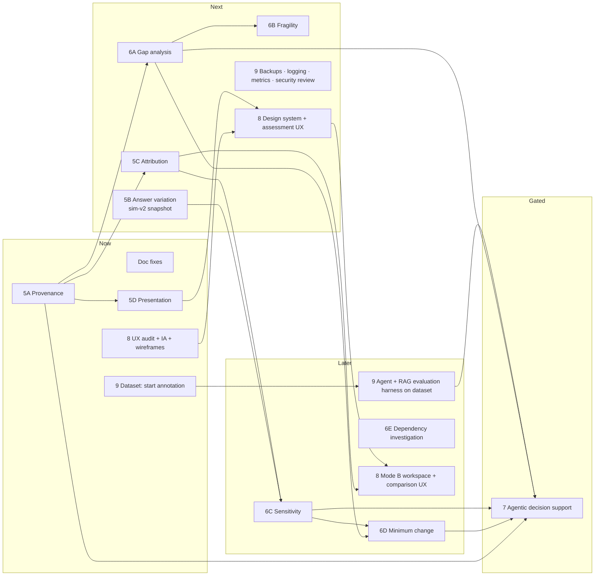

# TenderFit product roadmap: Phases 5–9

This roadmap builds on `main` at `bfe4015` (18 November 2026).

- Background: [TEAM_HANDOFF.md](TEAM_HANDOFF.md) covers the product and what exists; [ARCHITECTURE_REFERENCE.md](ARCHITECTURE_REFERENCE.md) covers the technical detail.
- **Progress since this roadmap was written:** Phase 5A and the assessment/simulation-result portion of 5D are implemented on `codex/remaining-phases`; see [PHASE5_PROVENANCE.md](PHASE5_PROVENANCE.md). Phase 9 annotation intake is prepared under `eval/validation/`, with human labels still pending. The remaining designs below are proposals.

Contents

1. [Where we are, and what to do next](#1-where-we-are-and-what-to-do-next)
2. [Prioritisation framework](#2-prioritisation-framework)
3. [Dependency-aware sequence](#3-dependency-aware-sequence)
4. [Phase 5: evidence-grounded scenario intelligence](#4-phase-5-evidence-grounded-scenario-intelligence)
5. [Phase 6: decision intelligence](#5-phase-6-decision-intelligence)
6. [Phase 7: agentic decision support](#6-phase-7-agentic-decision-support)
7. [Phase 8: frontend, HCI and product experience](#7-phase-8-frontend-hci-and-product-experience)
8. [Phase 9: production readiness and real-world validation](#8-phase-9-production-readiness-and-real-world-validation)
9. [Work that can run in parallel](#9-work-that-can-run-in-parallel)
10. [Risks across the roadmap](#10-risks-across-the-roadmap)

---

## 1. Where we are, and what to do next

**What is built.**

- **Mode A:** ingestion, documents, extraction with verification, hybrid retrieval, rules plus guarded model plus bounded agent, and dependency-tracked amendments.
- **Mode B:** isolated rules-only simulations, a bounded what-if agent, a scenario builder, variations and comparison.

**What is not true yet.**

- **Accuracy on real tenders has not been measured** ([TEAM_HANDOFF.md §12](TEAM_HANDOFF.md#12-known-limitations-and-open-questions)).
- **Mode B results are less inspectable than Mode A results.** A live verdict shows its quote, passage and facts, while a simulated verdict shows its facts and conditions but no citation: `engine._record_of` drops `Decision.citations` and `retrieval`.

**Recommended next milestone: Phase 5A + 5D (provenance and its presentation), together with the start of the Phase 9 validation dataset.** The reasons:

1. **Trust first.** Every later feature (gap analysis, sensitivity, minimum change, recommendations, a more capable agent) produces conclusions *from* simulated verdicts. If those verdicts cannot be traced to evidence, every later conclusion inherits the gap. Provenance is the foundation, not a polish item.
2. **It is small and low-risk.** The data is already computed: `decide()` returns citations, and the snapshot already holds the facts. The engine discards it, and the UI never asks for it. No new service is needed, and probably no migration (§4.A).
3. **The dataset has the longest lead time.** A labelled dataset needs annotators and weeks of calendar time, and it gates every accuracy claim, every agent evaluation and every threshold such as `RETRIEVAL_MIN_SCORE`. Starting it now costs little engineering, and waiting would stall Phases 6, 7 and 9 later.
4. **HCI research can start now** as an audit and wireframes ([§7.G](#g-design-process)), with no code, so the Phase 8 build has a tested design to implement.

Deferred on purpose: **advanced agent work (Phase 7)**. It depends on provenance (Phase 5), on deterministic analysis tools (Phase 6) and on an evaluation set (Phase 9). Building it first would produce fluent answers we cannot verify.

---

## 2. Prioritisation framework

Each candidate is scored 1 (low) to 3 (high) on five criteria. Complexity and risk are scored so that higher means *easier* and *safer*.

| Criterion | Question |
|---|---|
| User value | Does a supplier make a better or faster bid decision because of it? |
| Trustworthiness | Does it make conclusions more correct, traceable or honest about uncertainty? |
| Dependency position | Do other items need it first? |
| Complexity (inverted) | How much code and design, and how many modules does it touch? |
| Operational risk (inverted) | Could it break Mode A, isolation, authorisation or spend control? |

| Item | Value | Trust | Unblocks | Ease | Safety | Total | Class |
|---|---|---|---|---|---|---|---|
| 5A Provenance in simulated results | 2 | 3 | 3 | 3 | 3 | **14** | Product-critical |
| 9 Labelled validation dataset | 2 | 3 | 3 | 2 | 3 | **13** | Product-critical / research |
| 5D Evidence and uncertainty presentation | 3 | 3 | 2 | 2 | 3 | **13** | Product-critical |
| 8 UX audit and IA (design only) | 3 | 2 | 2 | 3 | 3 | **13** | Product-critical |
| 5C Multi-change attribution | 2 | 3 | 2 | 2 | 3 | 12 | Product-critical |
| 6A Evidence-gap analysis | 3 | 2 | 2 | 2 | 3 | 12 | Product-critical |
| 6B Fragility analysis | 3 | 2 | 1 | 2 | 3 | 11 | Product |
| 6C Sensitivity analysis | 2 | 2 | 2 | 2 | 3 | 11 | Product |
| 9 Security review, backups, observability | 1 | 3 | 2 | 2 | 3 | 11 | Technical debt / production |
| Documentation fixes ([TEAM_HANDOFF.md §13](TEAM_HANDOFF.md#13-where-older-documents-disagree-with-the-code)) | 1 | 2 | 1 | 3 | 3 | 10 | Technical debt (quick, do now) |
| 5B Requirement-answer variation | 2 | 2 | 2 | 2 | 2 | 10 | Product-critical |
| 6D Minimum-change exploration | 3 | 2 | 1 | 1 | 3 | 10 | Product / research |
| 6E Advanced dependency investigation | 2 | 2 | 1 | 2 | 3 | 10 | Nice-to-have |
| 8 Frontend build (after audit) | 3 | 2 | 1 | 1 | 2 | 9 | Product-critical |
| 7 Agent planning and recommendations | 3 | 1 | 1 | 1 | 1 | 7 | Research, gated |

The totals guide the order but do not override dependencies. 5B and the frontend build score lower only because they must wait for 5A and the audit; they stay product-critical.

**Balance.** Over the next two quarters, aim for roughly:

- 40% backend correctness and provenance (Phases 5 and 6);
- 25% frontend and HCI (Phase 8: audit first, then build);
- 20% evaluation and validation (Phase 9 dataset and harness);
- 15% production hardening (Phase 9 operations).

AI-agent research starts only when its gates in §6 are met.

---

## 3. Dependency-aware sequence



| Must wait for | Because |
|---|---|
| 5C attribution needs 5A | Attribution explanations must cite the evidence behind each moved verdict |
| 5B answer variation needs an engine version bump | Answers move from live inputs into the snapshot, which changes what `sim-v1` means |
| 6C and 6D need 5C | Sensitivity and minimum change *are* repeated attribution-style runs |
| 6B needs 6A's evidence model | Both read the same per-fact support data |
| Phase 7 needs 5A, 6A–6D and an evaluation set | Tools must exist and be correct before an agent orchestrates them, and agent quality needs measuring |
| 8 build needs the 8 audit | So we do not polish the wrong flows |

---

## 4. Phase 5: evidence-grounded scenario intelligence

**Objective.** Make every Mode B result as inspectable as a Mode A verdict, so that a supplier can see:

- which actual evidence supports it;
- which assumptions were introduced;
- which requirements were affected;
- why the outcome changed;
- where uncertainty remains.

### A. Evidence provenance in simulated results

**User stories**

- *As a supplier*, when a simulated verdict says `met`, I want to see the tender quote it was judged against and which of my facts it relied on, so I can check it.
- *As a supplier*, I want facts that exist only in the scenario to be visibly different from my real facts.

**Current state, verified.**

- `pipeline.decide()` returns a `Decision` with `citations` (for a rule decision, the requirement's own `(passage_id, quote)`), `facts`, `params`, `conditions` and `gaps`.
- `engine._record_of()` persists `status`, `reason`, `basis`, `facts`, `params`, `required`, `observed`, `question`, `needs_human`, `conditions`, `gaps` and `conflict`, but **not `citations`**.
- Snapshot facts (`rules.engine.Fact`) hold `evidence_status` and validity, but **no reference to the evidence file or quote** behind them (`fact_support`).

**Design**

1. **Keep citations.** Add `citations` to `_record_of` as a list of `{passage_id, quote}`. A rule decision has one, the requirement's source, so this adds no reads.
2. **Classify each fact used** in a result:
   - `actual`: a snapshot fact unchanged by any change;
   - `modified`: a snapshot fact changed by change ordinal *n*, with the field and the before and after values;
   - `hypothetical`: an added fact, with a negative id and its change ordinal;
   - `removed`: referenced only in control.

   `scenario.apply_changes` already knows which change touched which fact (`touched`), so record that mapping on the `Scenario`.
3. **Freeze evidence references in the snapshot.** Extend the snapshot's fact JSON with `support: [{evidence_file_id, page, quote, verified, human_verified}]`, read from `fact_support` at creation. This is a **snapshot schema change**, so bump `snapshot.ENGINE_VERSION` to `sim-v2`.
   - Old `sim-v1` simulations keep working and simply have no `support`.
   - `scenarios._integrity` already reports mixed engine versions in a comparison.
4. **Store the provenance in the result.** Put it in the existing `simulation_result.simulated` jsonb. **No migration**: the column is schemaless jsonb, so this is a code-only change. Shape: `simulated.provenance = {citations, facts: [{id, label, origin, change_ordinal?, support[]}], params: [{field, value, origin}]}`.
5. **API.** `GET /v1/simulations/{id}/results` already returns `simulated`. Add a resolver route, `GET /v1/simulations/{id}/results/{requirement_id}/provenance`, which returns the passage text (through the existing `screens._readable_document` access check) and evidence file metadata, scoped to the supplier. Regenerate `docs/openapi.json`.

**Modules affected:**

- `simulation/engine.py`, `scenario.py`, `snapshot.py`;
- `api/simulations.py`;
- `web/src/whatif/SimulationPage.tsx`, `api.ts`.

**Tests**

- Every `rule` row has a non-empty citation.
- Fact origin is correct for each of the nine change kinds.
- `sim-v1` rows still render.
- Live-table fingerprints are unchanged.
- Another supplier gets 404 from the provenance route.
- `selective=False` equivalence still holds.

**Acceptance**

- For every `rule` result, the API returns at least one citation and the origin of every fact used.
- The UI marks hypothetical and modified facts distinctly from actual ones.
- Nothing is written to live tables.

**Out of scope:** model-read provenance for `needs_model` rows (there is no model in Mode B evaluation).

### B. Requirement-answer variation

**User story.** *As a supplier*, I want to ask "what if I answered yes to this question?" without recording an answer on my real assessment.

**Current state, verified.**

- Answers are read live from `question` inside `pipeline.decide()` (lines ~346 and ~267, via `_lineage`) and are tracked as the `answers` live input in `simulation/inputs.py`.
- Overrides come from `confirm.overrides()` and only affect aggregation (`engine._v`).
- Neither is in the snapshot, which is why Phase 4 excluded them.

**Design options**

| Option | How | Pros | Cons |
|---|---|---|---|
| **B1 (recommended)** Freeze answers into the snapshot | `take_snapshot` stores `answers: {requirement_id: [answer…]}` per lineage; `decide()` gains an optional `answers=` parameter used instead of the query when given | Deterministic and hashable; follows the existing `conditions=` pattern in `decide()` | Touches `decide()` (shared with Mode A), so it needs care and the full Mode A suite |
| B2 Inject at run time | Read live, then override in memory | No snapshot change | Not reproducible; contradicts the frozen-input design |

With B1, add the change kind `set_requirement_answer {requirement_id, answer: str | null}` (`null` removes it). This needs:

- **migration 022** to extend the `simulation_change.kind` CHECK, keeping the other nine;
- the `changes.py` model;
- `scenario._apply`;
- `impact.reach`, where the answer targets `requirement:N`.

Overrides follow the same pattern: freeze `overridden` and add `set_override {requirement_id, on: bool}`. These affect the recommendation only, which `engine._v` already models.

**Guardrails**

- In Mode A, an answer only turns `unknown` into `needs_confirmation` "as a declaration". That stays true here: a hypothetical answer can never produce `met`.
- Live `answers` remain a tracked input for `sim-v1` only.

**Tests**

- With no answer given, `decide(answers=…)` behaves the same as before.
- A hypothetical answer moves `unknown` → `needs_confirmation`, never to `met`.
- Live `question` rows are untouched.
- Migration 022 applies twice cleanly.

**Acceptance.** A supplier can vary an answer in the builder, and the live `question` table is unchanged.

**Risks.** Regression in Mode A through the `decide()` signature. Mitigation: the default path is unchanged, plus the property tests in `test_rules_regression.py` and the soundness suite.

### C. Multi-change attribution

**User story.** *As a supplier*, when two changes both reach a requirement that improved, I want to know whether either alone would have done it.

**Current state.** `scenarios.reach_by_change` marks a moved requirement as `attributable` only when a single change reached it; otherwise it is `shared_with_other_changes`. No counterfactual runs are made.

**Design: deterministic counterfactuals, in the evaluation transaction.**

- For each requirement moved by *k* ≥ 2 changes that reach it, evaluate rules-only on:
  - each change alone (*k* runs);
  - all changes minus each one (*k* runs).
- These are in-memory `apply_changes` plus `decide(interpret=False)` calls; a full run on the fixture takes about 14 ms. Cap the work with an explicit budget (for example, at most 200 extra decide calls per run) and report `attribution: "not computed (limit)"` beyond it.
- **Classification per (requirement, change):**

  | Class | Meaning |
  |---|---|
  | `sufficient_alone` | This change alone gives the simulated status |
  | `necessary` | Removing it reverts the status |
  | `jointly_required` | Neither alone nor any single removal explains it; only the combination does |
  | `redundant` | Others give the same result without it |
  | `no_independent_effect` | Reaches the requirement, but never changes the outcome |

- **Statement policy.** Report these structural facts about the rules, never "caused" or a percentage. Where several changes are each `sufficient_alone`, say so; do not pick one.
- **Storage.** Put it in the summary or per-row jsonb (no migration). It is computed inside `isolation.read_only` with the other evaluations, so it sees the same snapshot.
- **Modules:** `simulation/engine.py` (a new `_attribute` step), `scenarios.reach_by_change` (read the new data when present), and the comparison UI.

**Tests**

- Hand-built cases for each class.
- Results do not depend on change order (property test).
- Budget exhaustion is reported.
- With one change, `attributable` agrees with the old logic.

**Acceptance.** No UI or API text claims individual causality where the class is `jointly_required` or `redundant`.

### D. Evidence and uncertainty presentation

Define one vocabulary and use it everywhere, in both Mode A and Mode B. These sources already exist in the data.

| Badge | Source |
|---|---|
| **Verified evidence** | `document_on_file` with a passing `fact_verification`, or `human_verified_by` |
| **Document on file, unchecked** | `document_on_file` with no verification or a failed one |
| **Declared** | `declared` (and whether `declaration_confirmed`) |
| **Missing / unknown** | `missing`, `unknown` |
| **Assumption (this scenario)** | Fact origin `hypothetical` or `modified` (5A) |
| **Rule conclusion** | `decided_by = rule` |
| **Model interpretation** | `decided_by` model or agent (Mode A only); `needs_model` in Mode B |
| **Needs a person** | `needs_human` (G2–G7) |

**Acceptance.** For a simulated verdict, a user can see on one screen the citation, each fact with its badge, the change that introduced any assumption, and what remains uncertain. A Testing Library test asserts the badges for each origin.

**Phase 5 out of scope:** model re-reading of reworded requirements in Mode B; any write to live tables; scoring.

---

## 5. Phase 6: decision intelligence

**Objective.** Move from single experiments to helping suppliers see what matters most, using **deterministic, reproducible analyses** built on the rules-only engine. Models explain; they do not compute.

### A. Evidence-gap analysis

**Problem.** "What are we missing, and what would fix the most?"

**Design**

1. **Classify each non-`met` verdict** from `verdict_condition` and fact selection:

   | Class | Meaning |
   |---|---|
   | `missing_documentation` | A fact exists but its `evidence_status` is `declared`, `missing` or `unknown` where proof is needed |
   | `incomplete_documentation` | A document is on file but verification did not confirm the amount, standard or expiry |
   | `capability_gap` | A current contrary fact gives `not_met` |
   | `unverified_claim` | Declared only |
   | `no_information` | No fact |

   Missing evidence is **never** reported as a capability gap; this follows the existing `not_met` rule.
2. **Rank remedies.** For each candidate remedy (make fact *f* `document_on_file`, or add a fact of the kind a condition names), run a rules-only simulation internally (`store.create` is not needed: use in-memory `apply_changes` and `decide`) and count which requirements move. Rank by mandatory blockers resolved, then uncertainties resolved.
3. **Output.** A read-only report per assessment. It is computed on demand in a READ ONLY transaction, so no new table is needed at first; cache it later only if it proves slow.

**API.** `GET /v1/lots/{id}/gaps?assessment_id=`

**Acceptance.** Every listed gap names its requirement, its citation and the evidence type, and every remedy states that it is hypothetical until real evidence is uploaded.

### B. Fragility analysis

**Problem.** "Which of our passes could fail?"

**Indicators**, all present in current data:

- `valid_until` before `lot.contract_end`, or close to the deadline (`profile/validity.check`);
- `confirm_by` soon (the capacity and workload families, 30 days);
- a single `fact_support` row behind a `met`;
- support not verified;
- a `met` resting on a G2 or G3 confirmation, or on a G6 override nearby;
- an evidence document older than a threshold.

Output each fragile `met` with its reasons. **No score**: a list of named reasons, like `evidence_quality`.

### C. Sensitivity analysis

**Problem.** "Which assumption matters most?"

**Design**

- Systematic sweeps, not LLM suggestions: for each numeric condition bound or fact value the snapshot holds, evaluate a small, fixed grid of values, including the threshold and one step either side. For each date, evaluate before and after the deadline.
- Report the **switch points**, the values at which a verdict changes.
- It is reproducible: the same snapshot gives the same sweep.
- It is bounded by an explicit limit on runs.
- It needs 5C's in-memory evaluation helper.

### D. Minimum-change exploration

**Problem.** "What is the smallest set of changes that clears these blockers?"

**Formulation**

- **Candidates** *C* are generated deterministically from the blockers' conditions. For example, set fact value ≥ bound, add a fact of the required kind, or set evidence to `document_on_file`.
- **Target** *T* is the set of requirements to move to `met` or `needs_confirmation`.
- **Objective:** minimise Σ cost(c) over the chosen set *S* ⊆ *C*, subject to every requirement in *T* reaching its target under rules-only evaluation. By default cost(c) = 1; the supplier may supply effort weights.

**Method**

1. Dependency-based reduction: keep only candidates whose `impact.reach` intersects *T*.
2. Decompose: requirements whose candidate sets do not overlap are solved independently.
3. For each component, use exact search for small sizes: subsets in order of increasing size, which gives a minimum-cardinality answer. Use branch-and-bound beyond that, with the current best as the bound and pruning by monotonicity where it holds (raising a value never breaks an `at_least`). Stop at a run limit and report "best found within limit", which is not optimal.

**Limitations to state in the product**

- The result is rules-only, and `needs_model` requirements are excluded.
- Candidates are what the rules can test, not what is commercially feasible.
- Costs are the supplier's estimates.
- **It is never a guarantee of tender success.**

### E. Advanced dependency investigation

Recursive CTEs over `dependency` and `passage_edge` can trace:

- requirement → passage → referenced section → definition;
- shared facts across requirements (`verdict_fact`);
- amendments that touched each node (`change_impact`).

Add indexes only where `EXPLAIN` shows need. **Do not introduce a graph database**: the current graph is one hop within one version, and two-hop paths already work in `retrieval/versioned.py`. Reconsider only if a measured query on a realistic corpus misses its latency target after indexing.

**Phase 6 acceptance.** A supplier can see:

- what they are missing (6A);
- which passes are fragile (6B);
- which assumptions matter (6C);
- which combinations clear blockers (6D);
- why a requirement remains unresolved (6E).

Every item carries a citation or a declared assumption.

**Phase 6 out of scope:** pricing; predicting buyer scores; any automatic change to the live profile.

---

## 6. Phase 7: agentic decision support

**Objective.** Evolve the one bounded what-if agent into an investigation assistant that orchestrates Phase 5 and 6 tools, measurably.

**Gates before starting**, all required:

1. Phase 5A provenance is shipped.
2. At least 6A and 6C are available as deterministic functions.
3. An agent evaluation set exists (§6.D).
4. The real-model smoke test has been run and recorded.

### A. Planning and tool orchestration

Keep **one agent** with a fixed tool list (the `simulation/agent.py` pattern), adding new read-only tools:

- `list_gaps`, `fragility`, `sweep`, `minimum_change`;
- `dependencies`, `read_passage` (supplier-scoped);
- `compare`, `change_impact`.

Each returns structured JSON from deterministic code.

The agent:

1. interprets the question;
2. selects requirements;
3. calls the tools;
4. explains.

The agent **never computes an authoritative verdict.** Its claims are validated against tool outputs, as `finish` already does for `changed`, and extended to cited requirements and quoted passages.

### B. Multi-step investigation

For example: "Why are we failing, and what is the smallest realistic set of changes?" The agent runs:

1. `read_baseline`;
2. `list_gaps` and blockers;
3. `read_passage` for each;
4. `minimum_change(T)`;
5. optionally build scenarios and `compare`;
6. `finish`, with citations and assumptions.

Budget: raise `MAX_TOOL_CALLS` only with measured need. The deadline and spend admission are unchanged in kind and checked before every call.

### C. Scenario recommendations

The agent may create **draft** scenarios, marked `proposed_by: agent`, that a person must open and run. Three states must be visually and semantically distinct:

- a suggested change;
- a user-approved simulation;
- a verified real capability, which only Mode A evidence can establish.

A proposal is never presented as something the supplier has.

### D. Evaluation and reliability

Build `eval/agent/`, a set of real-tender questions with expected tool use, expected changes and expected caveats, drawn from the Phase 9 dataset. Measure:

| Metric | How |
|---|---|
| Tool selection accuracy | Expected vs actual tool sequence (set and order) |
| Retrieval quality | Recall@k of labelled evidence passages |
| Citation accuracy | Share of quotes that pass `quote_ok` and the labelled entailment |
| Unsupported-claim rate | Claims not backed by a tool output (checked automatically where possible, then by a person) |
| Uncertainty identification | Recall of `needs_model`, drift and fragile items in the answer |
| Simulation consistency | Same question, repeated: same changes and results |
| Budget and deadline compliance | 100% required; any breach is a bug |
| Completion rate | `answered` / (`answered` + `budget` + `agent_unavailable`) |

Do not optimise for fluency. Report every metric with its interval, bootstrapped by notice as in `docs/RESEARCH_ROADMAP.md`.

**Architectural constraints (unchanged):**

- deterministic logic stays out of prompts;
- authorisation stays in the backend;
- budget and deadline are enforced before calls;
- tool outputs are structured;
- claims are validated;
- traces are preserved.

**Multi-agent orchestration only if** a measured failure of the single agent (for example, context-length limits on 80-requirement lots) cannot be fixed with better tools or summaries.

---

## 7. Phase 8: frontend, HCI and product experience

**Objective.** A coherent, trustworthy product for suppliers who do not know AI, RAG or simulation vocabulary. Treat this as an information-architecture and interaction problem, not a restyle.

### Current interface: what the audit should start from

These are observed in code, not yet tested with users.

- **Navigation.** The sidebar has Opportunities, Changes, Business profile and Bid preparation (`App.tsx`). Mode B has no top-level presence: it is a **What-ifs tab** on the lot assessment page, plus three separate routes (simulation, builder, compare) reached from inside it.
- **Assessment page** (`pages/Assessment.tsx`, about 400 lines). Tabs for Requirements, Documents and What-ifs, a recommendation header and a requirement detail panel.
- **Comparison.** It is reached only by ticking 2–4 rows in the what-if list, and the wide table relies on inner horizontal scroll on phones.
- **Design system.** It is minimal: 19 CSS custom properties in `styles.css`, components in `components/ui.tsx` (`Card`, `Tile`, `Tabs`, `Empty`, `Skeleton`, `ErrorNote`, `Toast`, `Icon`), `prefers-reduced-motion` respected, and breakpoints at 1150 px and 860 px. **No dark mode.** No frontend linter. API types are mostly `any` outside `whatif/api.ts`.
- **Accessibility.** Some is in place: `role="note"` banners, `sr-only` "(hypothetical)", labelled tabs. It has **never been tested with a screen reader**, nor in Safari or Firefox (`docs/LIMITATIONS.md`).

### A. UX research and information architecture

Primary journeys, as listed in the brief:

1. discover and open a tender;
2. understand its requirements;
3. assess eligibility;
4. inspect blockers and gaps;
5. ask a what-if;
6. build a scenario;
7. vary it;
8. compare;
9. decide what to do next.

For each journey, map today's screens and clicks, and mark dead ends, duplicated information and confusing transitions. The audit's checklist should include:

- the jump from the assessment to a separate simulation route;
- the "control vs baseline" vocabulary;
- where a supplier goes after a comparison.

**Proposed IA, to validate with users:**

```
Opportunities ─► Tender ─► Lot workspace
                             ├─ Overview      (summary, blockers, evidence coverage, next actions)
                             ├─ Requirements  (filterable list ▸ requirement detail with evidence panel)
                             ├─ Documents     (inventory, uploads, unread essentials)
                             └─ Explore       (Mode B workspace: questions, scenarios, variations, compare)
Business profile (facts, evidence, verification, fragility)
Changes (amendments and their effects)
Bid preparation (pursued lots, open questions, confirmations)
```

### B. Modern product interface

The work covers:

- **A design system:**
  - type scale and spacing scale;
  - semantic colour tokens: met, not met, needs confirmation, unknown, hypothetical, drift;
  - light and dark themes;
  - restrained borders and shadows;
  - focus styles;
  - one component per pattern (status chip, evidence badge, citation, fact card, change card, comparison cell).
- **Screen-by-screen improvements:**
  - navigation, dashboard (pursued lots, deadlines, changes needing attention);
  - tender discovery with filters that use plain names alongside CPV and ITL codes;
  - lot overview, requirement explorer;
  - profile and evidence management;
  - the Explore workspace, the builder, comparison and history.

**Stack.** Keep React, Vite and plain CSS custom properties. A component library is justified only if it measurably reduces accessibility defects, and then a headless one (for accessible primitives) rather than a styled framework. Upgrade `react-router` to 7 in its own PR, which closes the moderate advisories.

### C. Assessment experience

- **An executive summary in words.** Use the recommendation and its counts, for example "2 blockers, 5 to confirm, 14 met". **No percentage.**
- **Blockers first.** Each blocker comes with its citation and the evidence that would resolve it (from 6A).
- **Evidence coverage by document.** Show essential documents read versus not read, and make provisional status obvious.
- **Requirement explorer.** Filters by status, obligation, category and evidence badge, plus search.
- **Progressive disclosure.** The default shows the reason, citation and facts. Retrieval rationale, conditions and dependency details sit behind "How this was decided".

### D. Mode B workspace (Explore)

A dedicated lot-level workspace with:

- **Baseline context:** which assessment, when it ran, and what drifted since.
- **Questions:** the ask panel and history.
- **Scenarios:**
  - a list grouped by lineage, using `parent_id` to show variations as a tree;
  - a change editor with "actual vs hypothetical" for every value;
  - an evidence panel (5A and 5D);
  - an explanation of each run.

**Visual rule.** Anything hypothetical uses one consistent treatment: a dashed outline, an "Assumption" badge and a hypothetical colour token. It appears **only** inside Explore. Every page in Explore offers "Back to the real assessment".

### E. Advanced comparison

- **Side by side** for 2–4 scenarios, with sticky requirement labels.
- **Filters:**
  - "only changed", "only blockers", "only uncertain";
  - group by blockers resolved, introduced, uncertainties and needs-model.
- **Integrity notes as a banner at the top,** not a footnote, when scenarios are not on the same snapshot.
- **"Why do these differ?"** per requirement, from 5C attribution and 5A provenance.
- **Mobile:** a stacked card per requirement with a horizontal scenario carousel *inside* the card. **The page itself never scrolls sideways.**

### F. Interaction design

- Inline validation in the builder, using the API's 422 messages, which already name the change and field.
- Undo for safe actions, such as removing a draft change.
- A confirmation for discard.
- Progress feedback for queued and running questions; queue position is already available.
- Skeletons and useful empty states.
- Full keyboard navigation, tested with axe and a screen reader.
- No modal stacks.
- Motion only for state changes, and never when reduced motion is requested.

### G. Design process

1. Audit the current interface: a heuristic review plus five task-based sessions with suppliers or proxies.
2. List usability problems with severity.
3. Define two or three personas: a bid manager at an SME, an operations lead, a first-time bidder.
4. Propose the IA (above) and test it with a card-sort or tree-test.
5. Write design principles and the component inventory.
6. Produce wireframes for the overview, requirement detail, the Explore workspace, the builder and comparison.
7. Prioritise the build by journey value: assessment overview → requirement detail → Explore → comparison.

**Acceptance.** In a moderated test, a supplier new to TenderFit, with no guidance, can:

- explain the assessment;
- find a blocker and its source;
- build a hypothetical scenario;
- compare two alternatives.

The interface should also:

- pass automated accessibility checks (axe: no serious or critical issues);
- work at 375 px without page-level horizontal scroll;
- support light and dark themes.

**Phase 8 out of scope:** a rebrand; a mobile app; a new frontend framework.

---

## 8. Phase 9: production readiness and real-world validation

**Objective.** Make TenderFit reliable enough for real suppliers and real tenders, and **measure** how well it works.

### Engineering plan

| Area | Today (verified) | Plan |
|---|---|---|
| Real-model tests | `tests/live_agent_smoke.py`, manual and paid; no recorded result | Run it on every release candidate with a recorded result; add a Mode A live smoke (extract and verdict on one fixture) behind `LIVE_LLM=1` |
| Provider failure | Classified `LLMError` with `may_have_billed`; Mode A returns `unknown` "model unavailable; not guessed" | Add alerts on error rate; surface provider status in the UI |
| Security | Session auth, CSRF header, per-supplier scoping, SSRF checks; no independent review | External review and penetration test; fix DNS rebinding (resolve once, connect to that IP); password reset, MFA, account disable; audit log of sign-ins |
| Tenant isolation | `test_isolation.py`, 404 on foreign ids | Add a fuzz test that tries every route with another supplier's ids |
| Backups and recovery | None | Scheduled `pg_dump` plus WAL archiving; a documented, rehearsed restore |
| Migration safety | Forward-only; locks held for the run; CI applies twice | A pre-deploy dry run on a production copy; lock-timeout settings; an expand/contract pattern for breaking changes |
| Deployment | Compose, no TLS | A TLS-terminating proxy; secrets from the environment or a secret store; a documented runbook |
| Observability | Logs only | Structured JSON logs with request and job ids; metrics for job queue depth and age, job failure rate, assessment duration, LLM cost per day and per supplier, and `simulation_agent` outcomes; alerting |
| Cost monitoring | `llm_call` (Mode A), `simulation_agent_step` (Mode B) | A daily cost report from both; alert on anomalies |
| Rate limiting | Sign-in, plus Mode B admission | Per-supplier limits on uploads and assessment requests |
| Performance | Measured only on small fixtures | Load-test lots with 20–80 requirements; concurrent suppliers; check that one worker suffices or add workers (the queue already supports `SKIP LOCKED`) |
| Data retention and privacy | No deletion of facts or suppliers | Retention policy; supplier data export and deletion; a DPIA |
| Configuration | `.env.example`; placeholder `DATABASE_URL` default | Fail fast in production if defaults are in use |
| Onboarding | Hand-typed facts; ITL codes | Guided setup; a CPV and region picker; evidence upload with suggested facts (a person confirms each) |

### Real-world evaluation programme

- **Dataset.**
  - 20–30 frozen real notices across sectors, weighted to amendments; extend `eval/real/fts-2023`.
  - Fictional or consented supplier profiles.
  - Two annotators, one with procurement experience.
  - Labels for requirements, conditions, verdicts, evidence passages and amendment effects.
  - A test split frozen before tuning.
- **Measure**, with the existing harness (`tenderfit/eval/run.py`, arms B0–B5):
  - extraction precision and recall;
  - retrieval recall@k;
  - verdict accuracy and false-`met` rate;
  - citation accuracy;
  - amendment miss rate (RQ1);
  - simulation consistency (repeat runs);
  - agent metrics (§6.D);
  - user comprehension and time saved against manual assessment, in a small study.
- **Human review** is required for every high-impact conclusion (a `not_met` blocker, a "no blocker found" recommendation) during the validation period.

**Acceptance.** A written evaluation report with intervals, published before any accuracy claim is made, and an operational runbook used in at least one restore drill.

---

## 9. Work that can run in parallel

| Stream | Can start now | Blocks on |
|---|---|---|
| A. Mode B provenance (5A → 5D → 5C) | ✓ | — |
| B. Validation dataset and annotation (9) | ✓ | Annotators |
| C. UX audit, IA, wireframes (8.A, 8.G) | ✓ | Access to users or proxies |
| D. Ops basics: backups, structured logs, metrics (9) | ✓ | Hosting decision |
| E. Documentation fixes ([TEAM_HANDOFF.md §13](TEAM_HANDOFF.md#13-where-older-documents-disagree-with-the-code)) | ✓ | — |
| F. Answer variation (5B) | After 5A lands | `sim-v2` snapshot |
| G. Gap and fragility analysis (6A, 6B) | After 5A | — |
| H. Frontend build (8.B–F) | After the audit | Design system |
| I. Agent (7) | **No** | Gates in §6 |

Streams A, C, D and E touch disjoint files (`simulation/`, design documents, deployment, `docs/`), so they can proceed in separate branches without conflict. A and F both touch `simulation/` and `assessment/pipeline.py`, so run them in sequence.

---

## 10. Risks across the roadmap

| Risk | Where | Mitigation |
|---|---|---|
| A change to `pipeline.decide` regresses Mode A | 5B, 5C | Default path unchanged; full Mode A suite plus property tests; `selective=False` equivalence in Mode B |
| Snapshot version mixing confuses comparisons | 5A, 5B | `ENGINE_VERSION` bump; `_integrity` already names mixed versions; UI banner |
| Combinatorial cost | 5C, 6C, 6D | Explicit run limits, reported when hit; dependency reduction first |
| Analyses read as predictions | 6, 7, 8 | Fixed wording ("under the rules, on this copy"); no scores; `basis` fields; user testing of the wording |
| Agent fluency hides errors | 7 | Claim validation against tool outputs; evaluation set; human review |
| Hypothetical evidence leaks into real decisions | 5, 8 | One visual treatment, confined to Explore; no apply route; tests on labels |
| Scope creep in the redesign | 8 | Audit-driven priorities; journeys before screens |
| Accuracy is worse than hoped on real data | 9 | Better found now than after launch; the roadmap's order puts measurement early |
