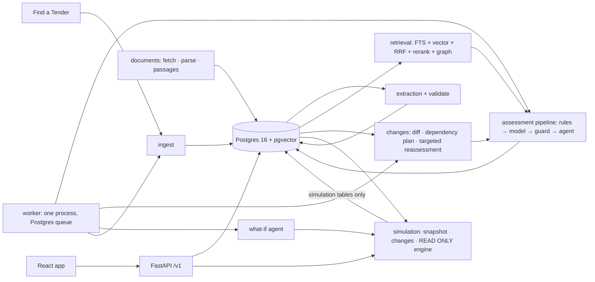

# TenderFit: engineering handoff

**Read this first.** It explains what TenderFit is, what has been built, how it works, how to run it and how to contribute without breaking it.

- State described: `main` at `bfe4015`, 18 November 2026. Every name, limit and route below was checked against that code.
- Companion documents:
  - [ARCHITECTURE_REFERENCE.md](ARCHITECTURE_REFERENCE.md): diagrams, module map, schema, invariants.
  - [PRODUCT_ROADMAP.md](PRODUCT_ROADMAP.md): Phases 5–9.

Contents

1. [What TenderFit is](#1-what-tenderfit-is)
2. [Architecture in one page](#2-architecture-in-one-page)
3. [Mode A: the foundation](#3-mode-a-the-foundation)
4. [Phase 1: isolated simulation API](#4-phase-1-isolated-simulation-api-pr-6)
5. [Phase 2: background what-if agent](#5-phase-2-background-what-if-agent-pr-7)
6. [Phase 3: what-if frontend](#6-phase-3-what-if-investigation-frontend-pr-8)
7. [Phase 4: scenarios](#7-phase-4-interactive-scenario-exploration-pr-9)
8. [Git and release history](#8-git-and-release-history)
9. [Backend architecture](#9-backend-architecture)
10. [Database](#10-database)
11. [Agent architecture](#11-agent-architecture)
12. [Known limitations and open questions](#12-known-limitations-and-open-questions)
13. [Where older documents disagree with the code](#13-where-older-documents-disagree-with-the-code)
14. [Getting started](#14-getting-started)
15. [Contribution workflow and rules](#15-contribution-workflow-and-rules)

---

## 1. What TenderFit is

### 1.1 The problem

A UK supplier who wants to bid for a public contract starts from a notice on **Find a Tender** plus a pack of documents: an invitation to tender, specifications, appendices and clarifications. Somewhere in those documents are the conditions that decide whether the supplier can bid at all. Typical examples:

- minimum insurance cover;
- certificates and standards;
- delivery windows;
- quantities;
- prior experience;
- financial thresholds.

Finding and checking them by hand is slow and error-prone:

- **The requirements are scattered.** One sentence says "see Appendix C"; Appendix C holds the number. Definitions change what words mean.
- **Matching is not keyword matching.** "£5m employers' liability" is not satisfied by a £10m *public* liability policy. A certificate that expires before the deadline does not count.
- **Tenders change.** Amendments move deadlines, quantities and conditions, and a supplier must redo the parts of the check that the amendment touched.
- **Mistakes are costly in both directions.** Bidding when a mandatory condition fails wastes the bid. Walking away from a winnable tender loses the work.

**Extraction alone is not enough.** A list of requirements still leaves the supplier asking two questions: *do we meet each one*, and *on what evidence*? An answer the supplier cannot trace back to the tender's own words and their own evidence cannot be trusted, and an answer that guesses when evidence is missing is worse than no answer.

### 1.2 What TenderFit does

TenderFit is a supplier-side decision-support tool. It:

1. imports notices from Find a Tender;
2. reads the documents;
3. extracts requirements, with source quotes that are verified against the text;
4. compares them with an evidence-labelled business profile;
5. returns a verdict per requirement, with the reason, the citations and the facts it used;
6. re-checks only what an amendment or profile change affects.

**It recommends; a person decides.** It never prices, commits or submits a bid. It is a **research prototype**: accuracy on real tenders has not been measured (see [§12](#12-known-limitations-and-open-questions)).

Its central method is a deliberate split:

- **Code checks what code can check:** numbers, dates, validity, logic and citations.
- **A language model reads what code cannot,** under checks it cannot override. A rule's answer binds the model's, every quote must exist in the source, and missing evidence is never treated as failure.

### 1.3 Two modes

| | **Mode A: Standard Assessment** | **Mode B: Impact & Exploration** |
|---|---|---|
| Question | *What is true now?* | *What could happen if…?* |
| Inputs | The supplier's actual facts and evidence, the actual tender | A frozen copy of one completed assessment, plus typed hypothetical changes |
| Output | Authoritative verdicts, recommendation, questions, confirmations | Hypothetical verdicts (control vs simulated), reach, comparison. **Never a verdict.** |
| Writes | Live tables | Only `simulation*` tables |
| Model | Extraction, verdict reading, bounded agent | Only the what-if agent, which **proposes** changes. Every simulated verdict is computed by rules. |

**Mode B must never silently alter Mode A.** This is enforced at four levels:

- the database: a READ ONLY transaction plus triggers;
- the module boundary: an import allow-list test;
- the API: no route applies a simulation;
- the UI: hypothetical banners and dashed verdict chips.

Hypothetical exploration matters because the useful question is often not "do we pass?" but "what would it take?":

- What if our insurance were raised to £10m?
- What if our test report were on file?
- What if the buyer accepted a 45-day lead time?

Answering these on the real profile would corrupt the record. Answering them in a frozen, isolated copy is safe and reproducible.

---

## 2. Architecture in one page

The diagrams are in [ARCHITECTURE_REFERENCE.md §1](ARCHITECTURE_REFERENCE.md#1-system-overview).



| Layer | Technology |
|---|---|
| Backend | Python ≥ 3.12, FastAPI, raw SQL with psycopg 3 (no ORM), pydantic 2 |
| Data | PostgreSQL 16 with pgvector (`pgvector/pgvector:pg16` image), full-text search, 21 numbered SQL migrations |
| Models | Anthropic (`claude-opus-5-5` by default, effort `medium`) for extraction, verdicts and agents; sentence-transformers `all-MiniLM-L6-v2` for embeddings; `cross-encoder/ms-marco-MiniLM-L-6-v2` for reranking |
| Documents | PyMuPDF (PDF), python-docx (DOCX), rapidfuzz (quote matching) |
| Background | One worker process with a Postgres `job` table |
| Frontend | React 18.3, react-router-dom 6.30, TypeScript 5.6, Vite 5, Vitest; served by nginx, which proxies `/api/` |
| Packaging | Dockerfile, `docker-compose.yml` (db, api, worker, web), `docker-compose.demo.yml` overlay |

---

## 3. Mode A: the foundation

Each step below is described in detail in [ARCHITECTURE_REFERENCE.md §3–5](ARCHITECTURE_REFERENCE.md#3-mode-a-the-assessment-lifecycle).

### 3.1 Tender ingestion (`tenderfit/ingest/`)

- **Fetching.** `FtsClient` fetches OCDS releases from `FTS_BASE_URL` in 24-hour windows (`IMPORT_CHUNK_HOURS`), with 60 minutes of overlap. A worker `import` job runs every 4 hours while `IMPORT_ENABLED` is true.
- **Raw storage.** Each release is stored in `raw_release` as **text, not jsonb**, because the API emits non-standard `Infinity` values (see `NOTES.md`).
- **Normalisation.** `normalise()` maps each release into `notice_version`. Versions are immutable (an update raises) and are numbered by the view `notice_version_numbered`, so out-of-order arrival never renumbers anything. It also maintains `opportunity`, `lot`, `buyer` and `linked_notice`.
- **Status.** Status is open, unverified, closed, awarded or cancelled. It is derived per lot, and freshness comes from one global import watermark.
- **Replay.** `replay()` is non-destructive. `destructive_rebuild()` is reachable only from the command line, with explicit flags and the exact database name.

### 3.2 Document processing (`tenderfit/documents/`)

- **Fetching.** `fetch()` retrieves only public addresses (`is_public_url`, checked on every redirect, 5 at most), up to 25 MB each. In practice Find a Tender attachments return 403 to automated clients, so real packs mostly arrive as **uploads** (`POST /v1/lots/{id}/documents`). Uploads are private to the supplier (`document.owner_profile_id`).
- **Parsing.** `parse_pdf` (PyMuPDF) and `parse_docx` produce blocks with headings and tables. Image-only pages are detected per page (under 40 characters and at least 20% image coverage) and reported. **There is no OCR.**
- **Passages and references.** `passages.build()` splits text under section headings into passages, each with a `tsv` (full-text) column and later an `embedding`. `references.find()` detects cues such as "see Appendix C".
- **Inventory and traceability.** `service.inventory()` lists each document reference with its status (`read`, `partial`, `unreadable`, `confirmed_none`, …). An essential document that was not read makes the result *provisional*. Every verdict cites `(passage_id, quote)`, and the UI opens the passage and document (`GET /v1/passages/{id}`, `GET /v1/documents/{id}/file`).

### 3.3 Requirement extraction (`tenderfit/extraction/`)

`extract_version()` sends batches of about 3,000 words to the model (`llm.json`, role `extract`) with a strict JSON schema (`schema.EXTRACTION_SCHEMA`). Each requirement carries:

- a statement and quote;
- a category: `quantity`, `delivery`, `experience`, `standard`, `certificate`, `insurance`, `financial` or `other`;
- an obligation;
- a lot, references and defined terms;
- `evidence_needed`, `equivalent_allowed`;
- atomic conditions.

Validation (`validate.py` and `extract.verify`) decides what is trusted:

| Check | Effect |
|---|---|
| Quote fuzzy match ≥ 95 (`QUOTE_THRESHOLD`) against the cited passage or its neighbours, **and** the same digit sequences | Otherwise the requirement is rejected (`requirement_rejection`), kept and shown |
| Lot number known | Otherwise rejected |
| Each condition traceable to the quote: numbers stated, units, `ALLOWED_FIELDS` such as `lot.quantity` or `notice.deadline` | Otherwise the machine check is dropped and the requirement is kept for the model |

The result is stored in `requirement`, `requirement_condition` and `dependency` (references, definitions, parameters). Mandatory requirements that were rejected lower the recommendation: "no blocker" becomes "needs confirmation".

### 3.4 Hybrid retrieval (`tenderfit/retrieval/`)

When rules cannot settle a requirement, the model is given passages retrieved as follows (`search.search`):

| Stage | Detail (verified in code) |
|---|---|
| Lexical | Postgres `to_tsquery('english')`: an OR of query terms with stop words and terms of ≤2 characters removed, ranked by `ts_rank_cd`, top **50** |
| Vector | `all-MiniLM-L6-v2`, normalised embeddings, pgvector cosine (`<=>`), top **50** |
| Graph | Passages the requirement itself names, one hop along `passage_edge` (`REFERENCES`, `DEFINED_BY`), at most 6 |
| Fusion | Reciprocal Rank Fusion with k = **60** |
| Rerank | Cross-encoder `ms-marco-MiniLM-L-6-v2` on the top **20** |
| Output | Top **5**, plus every graph-linked passage. Each hit records why it was retrieved |
| Corrective | A second search for unresolved references (`CORRECTIVE_MAX_ATTEMPTS = 1`) |
| Threshold | `RETRIEVAL_MIN_SCORE` is unset: no evaluated value exists |

**Why hybrid and not vectors alone.** Tender text depends on exact tokens: standard numbers, money, section labels. Dense similarity blurs these, and full-text search catches them. Vectors catch paraphrase. RRF merges the two rankings without score calibration, and the cross-encoder reads the query and passage together. Graph links make sure "see Appendix C" brings Appendix C, whatever its similarity score.

Model weights are copied into RAM after loading (`_materialise`), because torch on macOS returned NaN from memory-mapped weights.

### 3.5 Supplier assessment

**Profile** (`tenderfit/profile/`). A supplier (`business_profile`) has typed facts (`profile_fact`). The attributes are capacity, experience, certificate, test_report, insurance, region, product, service and registration. Each fact has:

- a value;
- an `evidence_status` (`document_on_file`, `declared`, `missing`, `unknown` or `needs_update`);
- validity dates (`valid_until`, `confirm_by`).

Evidence files (`evidence_file`, `evidence_page`) are linked to facts by quote (`fact_support`). Automatic checks (`verify.verify_fact_evidence`) read the text layer for the supplier name, standard, amount and expiry. They **cannot detect forgery**.

**Decision** (`assessment/pipeline.decide`), for each requirement:

1. **Rules first.** `rules.engine.evaluate` judges each condition (`at_least`, `at_most`, `min_amount`, `within_years`, `region_covered`, `has_evidence`, `valid_through`), with fact scoping, units and validity at the deadline. Bad input never raises; it is handed on as "needs model".
2. **Model for what rules cannot read.** The open conditions go to `llm.json("verdict")` with retrieved passages and relevant facts, through `verdict_cache`.
3. **Guard** (`guard()`).
   - Citations must be found in the passages.
   - `not_met` needs a **current** contrary fact.
   - `met` needs a current supporting fact, and real proof where the buyer asks for it.
   - Any rejected citation lowers `met` to `needs_confirmation`.
4. **Rules bind the model** (`_combine`). The model can never lift a condition a rule did not accept.
5. **Agent** (optional, `agent/loop.py`). It runs for escalated requirements that rules did not settle, using 8 read-only tools within the lot budget ($0.50, 400k tokens, 180 s). Its verdict is guarded again.
6. **Gaps and conflicts.** An unread reference, or two documents that disagree, lowers `met` to `needs_confirmation`.

**The four verdicts and why the distinctions matter:**

| Verdict | Meaning | Why it is distinct |
|---|---|---|
| `met` | Every mandatory part is satisfied by current, compatible, sufficiently proven facts | The only state that needs no action |
| `not_met` | Explicit, current evidence contradicts it | A real blocker. Kept rare on purpose: a false blocker makes a supplier walk away from work they could win |
| `needs_confirmation` | Support exists, but must be confirmed or proven, or the sources disagree | Something to *do*: upload a document, confirm a declaration, ask the buyer |
| `unknown` | Nothing settles it | Missing information, **not** a failure. Treating it as `not_met` would turn missing paperwork into a false "no" |

The recommendation (`rules/aggregate.dimensions`) combines the verdicts with document coverage, relevance (CPV and region overlap) and rejected mandatory extractions. The labels are "Blocker found", "Not assessed", "Provisional", "Relevant: N items need confirmation" and "Relevant: no mandatory blocker found". **No percentage is shown, because none is calibrated.**

**People confirm** at points G1–G7 ([ARCHITECTURE_REFERENCE.md §3.3](ARCHITECTURE_REFERENCE.md#33-human-confirmation-points)). Each confirmation is stored with who made it and when. A G6 override turns a `not_met` into `needs_confirmation` in the recommendation, and the original verdict is kept.

### 3.6 Amendments and the dependency model (`tenderfit/changes/`)

1. An import finds a new notice version behind current assessments and enqueues `detect_changes`.
2. `diff.py` aligns fields and passages between the two versions, and `classify()` flags structural changes: award criteria, selection, definitions, or a change in lot count.
3. Each verdict's **dependencies** say what it relied on: facts, rule parameters such as `notice.deadline` and `lot.quantity`, and the passages and documents it read. `impact.plan_reassessment` intersects the changed targets with one assessment's dependencies.
4. **Targeted reassessment** carries verdicts whose dependencies did not change, and re-decides the rest. Requirements whose source passage changed are re-extracted and paired with the old ones (token-set ≥ 70) for a before/after explanation. Structural or ambiguous changes reassess everything.
5. Processing runs under an advisory lock (`AMENDMENT_LOCK`). Each pair is recorded in `change_impact` in the same transaction as its assessment. A failed event retries with backoff (at most 5 attempts) and can be retried by hand (`POST /v1/changes/{id}/retry`).
6. Pursued lots (G1) get a `shadow_full` audit. Missed dependencies are recorded, which measures the planner on real changes.

Profile changes use the same targeted path: a fact edit, new evidence, a G4 renewal, or a daily expiry from `daily_check`.

---

## 4. Phase 1: isolated simulation API (PR #6)

- Merge commit `724c183`. The PR holds three commits:
  - `7144ae5`: the API itself;
  - `b219249`: abandoned-run recovery and execution input-drift fixes;
  - `09ffd8c`: the plan document with Phase 1 as built, which is the milestone tip.
- Before Phase 1, the simulation package had been built in stages 4–7 and merged in PR #5 (`431541c`). Phase 1 exposed it over HTTP.

**What it provides**

- **Frozen baseline snapshots.**
  - `snapshot.take_snapshot` copies one *completed, non-shadow* assessment's requirements, baseline verdicts and conditions, the tender context fields and the date (`as_of`).
  - It also copies the supplier's facts **as they are in the live profile at creation**.
  - The canonical JSON is hashed into `snapshot_sha256`, which is rechecked before every run.
- **Typed hypothetical changes.** Nine kinds ([ARCHITECTURE_REFERENCE.md §6.4](ARCHITECTURE_REFERENCE.md#64-the-nine-change-kinds)), validated for shape and then against the snapshot in order.
- **Separate storage.** `simulation`, `simulation_change` and `simulation_result` (migration 019) point at live tables. No live table points back or gained a column.
- **Lifecycle.** created → running → completed or failed, and any of those → discarded, enforced by a trigger. Changes are append-only while the simulation is created. It runs once.
- **Evaluation engine** (`engine.run`).
  - Three phases: start (guarded update) → evaluate inside `isolation.read_only` (READ ONLY + REPEATABLE READ) → record results and status in one transaction.
  - It reuses `pipeline.decide(..., interpret=False)`, so **no model is called and nothing is spent**.
  - A requirement only the model could decide is `needs_model`, never guessed.
- **Impact analysis** (`impact.reach`). This combines recorded dependencies ("used") with what each condition can read ("examines"). Only reached requirements are recomputed; `selective=False` recomputes all of them and raises if the analysis was incomplete.
- **Result comparison.** Each requirement gets baseline, control and simulated statuses. *Effect* is control → simulated. *Drift* is baseline → control, which is reported but never credited to the hypothesis.
- **Supplier authorisation.**
  - The supplier comes from the session.
  - Every store function is scoped to `profile_id`.
  - Another supplier's simulation is 404.
  - The baseline foreign key `(baseline_assessment_id, profile_id, lot_id, version_id)` proves ownership in the schema.
- **Abandoned-run recovery.** A run holds a session-level advisory lock. If its process dies, Postgres releases the lock, and `close_abandoned_runs` closes it as failed. A live run is never closed, however long it takes.
- **Frozen vs live inputs and drift.** See [ARCHITECTURE_REFERENCE.md §6.2](ARCHITECTURE_REFERENCE.md#62-frozen-and-live-inputs).
  - Some live inputs are read at run time: overrides, answers, requirement rows, documents, rejections and the baseline record. They are digested (sha256) at creation and again at run.
  - Differences are reported as `input_drift`, per requirement where possible, together with `summary.execution`.

**How the four terms differ**

| Term | Meaning |
|---|---|
| Frozen inputs | In the snapshot, covered by `snapshot_sha256`. They cannot change |
| Live tracked inputs | Read from live tables during the run, so they can change between creation and run |
| Input fingerprints | The sha256 digests of each live input, stored at creation (`drift.live_inputs_at_creation`, internal) and at run (`summary.execution.live_inputs[*].at_run`) |
| Simulation results | `simulation_result` rows plus `simulation.summary`: what the rules concluded with and without the changes |

**What prevents a hypothetical operation from changing the actual assessment**

1. Evaluation runs in a Postgres READ ONLY transaction, so even reused Mode A code cannot write.
2. `store.py` is the only writer, and it writes only simulation tables.
3. Only `api/simulations.py` and `jobs/worker.py` may import the package, and a test enforces it.
4. There is no "apply" route.
5. Tests compare a fingerprint of every live table before and after.

**Limitations that remain from Phase 1**

- `set_requirement_text` is always `needs_model`, because Mode B has no model reading.
- The recommendation is `complete: false` whenever a change reaches a `needs_model` requirement.
- Response bodies have no declared OpenAPI schemas.

---

## 5. Phase 2: background what-if agent (PR #7)

Merge commit `7ec33d6`; milestone commit `588332d`.

**The flow** (diagram in [ARCHITECTURE_REFERENCE.md §7](ARCHITECTURE_REFERENCE.md#7-the-what-if-agent)):

1. `POST /v1/assessments/{id}/what-if` with `{question (1–2000 chars), as_of?}`.
2. Under the supplier's spend lock (`spend.supplier_lock`), the API checks admission:
   - **409** if the supplier already has a what-if job queued or running (one at a time per supplier);
   - **429** with `Retry-After` if the rolling 24-hour spend cannot cover a whole session (`frees_at(session_usd)`);
   - **429** if 20 or more what-if jobs are queued across all suppliers.
3. `agent.begin()` creates the simulation and records the question as step 1. No model is called in the request.
4. The API enqueues one `simulation_agent` job with `max_attempts=1` and returns **202**.
5. The **existing worker and queue** run it (`run_simulation_agent` → `agent.investigate`). What-if jobs are low priority: they are claimed after every ready job of any other kind (`queue.LOW_PRIORITY`).
6. `GET /v1/jobs/{id}` reports `waiting_behind`, the queue position. `GET /v1/what-if/allowance` reports `daily_usd`, `session_usd`, `spent_24h_usd`, `remaining_usd`, `can_ask`, `next_question_at` and `active`.

**Limits from the code.** The settings in `config.py` are read at each check and never captured at import.

| Limit | Value | Where |
|---|---|---|
| Supplier daily spend, rolling 24 h | $5.00 | `SIMULATION_AGENT_DAILY_USD` |
| Per-session cost cap (reserved at admission) | $0.50 | `SIMULATION_AGENT_SESSION_USD` |
| Session deadline, from the worker start | 150 s | `SIMULATION_AGENT_DEADLINE_S` |
| Output tokens per call | 4096 | `SIMULATION_AGENT_MAX_TOKENS` |
| Queue cap (all suppliers) | 20 | `SIMULATION_AGENT_QUEUE_MAX` |
| Tool calls per session | 12 | `agent.MAX_TOOL_CALLS` |
| Minimum time left to start a call | 15 s | `spend.MIN_CALL_S` |
| Call timeout | remaining − 5 s, capped at `LLM_TIMEOUT_S` (300) | `spend.CALL_MARGIN_S` |
| SDK retries | 0 | `investigate()` call options |
| Job attempts | 1 (never retried) | `enqueue(..., max_attempts=1)` |
| Stale running job reclaimed after | 10 min (other jobs 1 h) | `queue.AGENT_STALE_AFTER` |

**How unlimited spend is prevented.** Before **every** model call, `spend.admit_call` takes the supplier's advisory lock and checks the call's *worst case* against both the rolling day and the session:

- input is estimated at 3 characters per token, which overestimates;
- output is priced at the full `max_tokens`;
- an unpriced model is costed as the most expensive.

Spend is the sum of `simulation_agent_step.cost_usd`.

**Provider failures versus failed simulations.**

- A provider error makes the session end with outcome `agent_unavailable`, recorded as an `llm_error` step. This covers HTTP 5xx and 408, connection errors, timeouts, refusals and output that hit `max_tokens`.
- If the call may have been billed (`may_have_billed`), its cost is booked at the worst case; if a response arrived, its real usage is used.
- The **simulation itself is not failed**: it stays as it was, and the job completes. The answer says the model could not be reached and that nothing was guessed.
- A simulation is *failed* only when its rules-only run fails.

**Traces.** Every step (question, tool calls, `no_tool`, `llm_error`, `end`) is its own small transaction in `simulation_agent_step`, with input, output, model, tokens and cost. `GET /v1/simulations/{id}/trace` returns it. Nothing goes to `agent_step` or `llm_call`.

**Recovery.**

- If a worker dies mid-session, the stale job is closed after 10 minutes as failed and not rerun, which frees the supplier to ask again.
- A discarded simulation stops the agent: the trigger refuses new steps, and the worker reports "discarded while it was being investigated".

**Agent limitations**

- The agent reads only the snapshot. It has no passage search, no evidence files and no clarifications.
- It can express only the nine change kinds. Price, staffing narratives and similar questions end as `unsupported`.
- One question per supplier at a time; one worker serves everyone, one job at a time.
- **Real-model smoke test.** `tests/live_agent_smoke.py` exists. It is deliberately not collected, because its name does not match `test_*.py`, and it fails without `LIVE_LLM=1` because CI treats skips as failures. `docs/SIMULATION_API_PLAN.md` §0 records one earlier measurement with the real model (about 12 s and $0.06–0.08 per answered question on the 4-requirement fixture) and §13 says the live smoke test *through the API* has not been done. **I could not verify either claim in this handoff:** no key was used, and no result file is in the repository.

---

## 6. Phase 3: what-if investigation frontend (PR #8)

Merge commit `f71ef3e`; milestone commit `edb94d5`.

| Feature | Where | Behaviour |
|---|---|---|
| Entry point | `pages/Assessment.tsx`, tab **What-ifs** | Shown only when an assessment result exists |
| Question panel | `whatif/AskPanel.tsx` | Natural-language question, optional "as of" date, the allowance line ("Today's AI allowance is used up. You can ask again from …"), and a refusal note for busy (409), allowance (429) and queue-full (429) responses, with a retry where it makes sense |
| History | `whatif/SimulationList.tsx` | The lot's simulations with status. Phase 4 added checkboxes, **Compare** and **Build a scenario** |
| Investigation | `whatif/useInvestigation.ts` | Controlled polling every 2.5 s, slowing to 10 s after 60 polls (about the session deadline). Reads the simulation, job (`waiting_behind`) and trace |
| Result | `whatif/SimulationPage.tsx` (`/lots/:lotId/simulations/:simId`) | `HypotheticalBanner` ("Hypothetical. Your assessment, your profile and the tender are unchanged. This is not a verdict."); hypothetical verdicts as **dashed, labelled chips** (screen readers hear "(hypothetical)"); tiles for changed, differ-for-other-reasons and needs-model counts; a per-requirement table; caveats; the agent trace; a drift explanation ("Without the changes" differs from your assessment because something live changed) and notes such as "The buyer has published a newer version of the tender" |
| Discard | Simulation page | `POST /simulations/{id}/discard`; the simulation stays visible with status discarded |
| Labels | `whatif/describe.ts` | Plain-language descriptions of changes and evidence statuses |

**How the UI separates hypothetical from authoritative.** Hypothetical results are kept off the assessment page itself and live in a tab and on separate routes. The banner is present on every simulation view, and the verdict chip style cannot be confused with the real pill. Drift is described as "differs for other reasons", never as an effect of the hypothesis.

---

## 7. Phase 4: interactive scenario exploration (PR #9)

Merge commit `bfe4015`; milestone commit `628ffe1`. The design notes are in `docs/SIMULATION_API_PLAN.md` §14.

### 7.1 Manual scenario creation

- **Builder.** `whatif/ScenarioBuilder.tsx` lives at `/lots/:lotId/scenarios/new?assessment=…`, or `?from=<simulation>` for a variation.
  - Its inputs come from `GET /v1/lots/{id}/simulation-inputs?assessment_id=` or `GET /v1/simulations/{id}/inputs`, via `scenarios.view`: requirements with the conditions each accepts, facts with `editable_keys`, fields, fact kinds and evidence statuses.
  - It offers **eight** change kinds. `set_requirement_text` is left out, because rules cannot decide reworded requirements.
- **"Actual" values beside each edit.** Choosing `document_on_file` or `declared` for evidence the supplier does not hold shows a **"Hypothetical evidence"** note.
- **Batch validation.** `POST /v1/simulations` with `changes` is **atomic**: every change is validated against the snapshot in order, and nothing is created if any one fails (`store._checked`).
- **Limits.**
  - At most **25** changes per scenario (`MAX_CHANGES`), enforced by the API model and by `store.add_change`.
  - Each change's JSON is at most **4000 bytes** (`MAX_CHANGE_BYTES`).

### 7.2 Scenario variations

- `POST /v1/simulations/{id}/variations` (`store.create_variation`) copies the parent's **snapshot and hash exactly**, reads fresh live-input digests and records `parent_id`.
- A discarded parent gives 409.
- **Migration 021** adds three things:
  - the column `parent_id`;
  - the unique index `simulation_lineage_key (id, profile_id, baseline_assessment_id, snapshot_sha256)`;
  - the foreign key `simulation_parent_fkey`, which forces a child to share its parent's supplier, baseline and exact snapshot.

  `simulation_guard()` adds `parent_id` to the immutable fields. The database, not only the code, guarantees that a variation is comparable with its parent.

### 7.3 Multi-scenario comparison

`GET /v1/lots/{id}/simulations/compare?ids=a,b[,c,d]` (`scenarios.compare`) compares 2–4 of the caller's completed scenarios from one lot.

- **Cells.** Each requirement × scenario cell holds the control and simulated status and a direction: `improved`, `worsened`, `unchanged`, or `undetermined` (needs the model to read).
- **Order** (`ORDERING`). Scenarios are listed by mandatory blockers resolved (most first), then blockers introduced (fewest first), then id.
- **Transitions are counted by name.** There is no score.
- **Highlights.**
  - `blockers_resolved`: mandatory `not_met` → `met` or `needs_confirmation`.
  - `blockers_now_unknown`: `not_met` → `unknown`. This is **not** counted as resolved: the blocker became an unknown, not a pass.
  - `blockers_introduced`, `uncertainties_resolved`, `now_needs_confirmation`, `needs_model`.
- **Integrity** (`_integrity`). The comparison reports whether the scenarios share a snapshot, the same `as_of`, the same engine version, and the same live-input digests at run time, plus drift between creation and run. Every difference is named in `notes`.

### 7.4 Impact prioritisation

`reach_by_change` and `priorities` report, for each change:

- the requirements it reached (from the run's recorded reach reasons);
- those that moved;
- those **attributable** to it alone (no other change in the scenario reached them);
- those **shared** with other changes;
- those undetermined;
- whether it assumes evidence the supplier does not hold.

`priorities` groups changes across the compared scenarios into:

- `widest_reach`
- `addresses_blockers`
- `resolves_uncertainty`
- `introduces_blockers`
- `little_or_no_effect`
- `depends_on_evidence_not_held`

**What these results mean, and what they do not:**

- They mean: under the rules, on this frozen copy, these changes move these verdicts.
- They do not mean: the buyer will score you higher, the bid will win, or the change is achievable.
- "Attributable" is a structural statement ("only this change reached it"), not a causal estimate. The `basis` field says so.

### 7.5 Known limitations of Phase 4

- **Answers to requirements cannot be varied.** Answers are live inputs read from `question` at run time, not part of the snapshot. Overrides are the same.
- **No individual attribution when several changes reach one requirement.** The move is shown as shared.
- **Scenarios frozen separately may not be directly comparable.** Each holds facts as they were in the live profile when it was created. The integrity notes say so, but nothing re-bases them.
- **Simulated results have no citations.** `engine._record_of` keeps facts, parameters, conditions and gaps, but not `Decision.citations` or `retrieval`. A simulated verdict therefore cannot show its supporting quote and passage the way a live verdict does. This is the main motivation for Phase 5.

---

## 8. Git and release history

`main`, first-parent history:

```
bfe4015 Merge pull request #9  feature/simulation-scenarios   (Phase 4)
f71ef3e Merge pull request #8  feature/simulation-frontend    (Phase 3)
7ec33d6 Merge pull request #7  feature/simulation-agent-jobs  (Phase 2)
724c183 Merge pull request #6  feature/simulation-api         (Phase 1)
431541c Merge pull request #5  feature/isolated-simulations   (simulation stages 4–7)
6669600 Merge pull request #1  release-hardening
2b0bce3 … earlier direct commits (R0–R2 builds, screens, demo)
```

| PR | Phase | Branch | Milestone commit | Merge commit |
|---|---|---|---|---|
| [#6](https://github.com/lachgarsamia/TenderFit/pull/6) | Simulation API | `feature/simulation-api` | `09ffd8c` (tip of `7144ae5`, `b219249`, `09ffd8c`) | `724c183` |
| [#7](https://github.com/lachgarsamia/TenderFit/pull/7) | Agent jobs | `feature/simulation-agent-jobs` | `588332d` | `7ec33d6` |
| [#8](https://github.com/lachgarsamia/TenderFit/pull/8) | Frontend investigation | `feature/simulation-frontend` | `edb94d5` | `f71ef3e` |
| [#9](https://github.com/lachgarsamia/TenderFit/pull/9) | Interactive scenarios | `feature/simulation-scenarios` | `628ffe1` | `bfe4015` |

**How the stack was consolidated.**

- The four PRs were opened as a stack, each targeting the previous phase's branch. #7, #8 and #9 contained exactly one commit each, and #6 contained three.
- They were merged in order on 18 November 2026 with **merge commits**, not squash or rebase, so the milestone commits are unchanged in `main`.
- After each merge, the next PR was retargeted to `main` and CI on `main` was allowed to pass before the next merge. All four runs passed backend, web, secrets and compose; the last was run `44305300278`.
- The tree at `bfe4015` is identical to `feature/simulation-scenarios`.

**Branches.** The feature branches **still exist on GitHub**: `feature/simulation-api`, `-agent-jobs`, `-frontend`, `-scenarios`, `feature/isolated-simulations`, `release-hardening`, and three `codex/versionrag-*` branches. None was deleted. They are merged and safe to delete when the team decides to.

**Local working trees.**

- Do not assume yours is clean.
- `TenderFit_Technical_Audit.md` may exist untracked at the repository root. **Leave it alone:** do not add, commit, move or delete it.
- `.claude/launch.json` is gitignored local configuration.

**Starting new work safely**

```bash
git fetch origin
```

```bash
git status
```

```bash
git switch main
```

```bash
git pull --ff-only
```

```bash
git switch -c feature/<short-name>
```

If `git pull --ff-only` refuses, your `main` has diverged. Stop and find out why; do not reset over it.

---

## 9. Backend architecture

The full module map is in [ARCHITECTURE_REFERENCE.md §2](ARCHITECTURE_REFERENCE.md#2-module-map).

- **Entry points.**
  - API: `uvicorn tenderfit.api.main:app`. It runs migrations at startup.
  - Worker: `python -m tenderfit.jobs.worker`. It also migrates, then loops.
  - CLIs: `python -m tenderfit.db migrate`, `python -m tenderfit.auth …`, `python -m tenderfit.demo load|amend|reset`, `python -m tenderfit.ingest …`, `python -m tenderfit.eval regression|run`.
- **Routes.** These are grouped in `api/accounts.py`, `assessments.py`, `screens.py` and `simulations.py`, mounted on one `/v1` router with `check_csrf`. Handlers are synchronous `def` functions that run in FastAPI's thread pool, each opening its own connection.
- **Authentication and authorisation.**
  - Argon2id passwords.
  - Session tokens are stored only as SHA-256, in the `tf_session` cookie, `Secure` by default.
  - Login lockout after 10 failures for 15 minutes.
  - `deps.current_user` re-checks membership on every request, and `current_profile` is the session's active supplier.
  - **No route accepts a supplier id from the client.** Another supplier's resource returns 404.
  - Non-GET requests need `X-TenderFit`.
  - Workers act for the supplier named in the job payload, which the API set from the session.
- **Ownership checks.** Owned rows are reached through `profile_id`, as in `_own_fact` and `store._row`. Public tender data has no owner. Supplier uploads, the requirements extracted from them, and per-supplier document decisions carry `owner_profile_id` or live in `document_ref_state`, and every reader filters on it.
- **Database access.** This is raw SQL with psycopg 3 and `dict_row`. Transactions are explicit: assessment runs commit once at the end, and simulation functions own their transactions and require an idle connection (`require_idle`). Advisory locks used:
  - `42`: migrations;
  - `AMENDMENT_LOCK = 7002`;
  - `RUN_LOCK` "SIM": simulation runs;
  - `SPEND_LOCK` "SSP": per-supplier spend.
- **Migrations.** These are numbered SQL files, forward-only, each applied once and recorded in `schema_migration`, all under an advisory lock. There are no down-migrations, and locks are held for the whole run (`docs/MIGRATION_VALIDATION.md`).
- **Jobs and worker.** See [ARCHITECTURE_REFERENCE.md §9](ARCHITECTURE_REFERENCE.md#9-jobs-and-the-worker).
- **LLM abstraction.** `llm.LLM` is a protocol with `json` and `tool_turn`. Implementations:
  - `AnthropicLLM`: the beta messages API with server-side fallback; errors are classified with `may_have_billed`.
  - `RecordedLLM`: replays and records by request hash, for evaluation.
  - `DemoLLM`: scripted.
  - The test fakes in `tests/fakes.py`.

  `log_call` writes Mode A usage to `llm_call`. `untrusted()` wraps document text so the model treats it as data.
- **Configuration.** All settings are in one `Settings` class ([ARCHITECTURE_REFERENCE.md §14](ARCHITECTURE_REFERENCE.md#14-configuration-reference)).
- **Errors.**
  - Domain errors map to 404/409/422/429 with user-facing messages.
  - Unexpected errors are logged and return a generic 500.
  - Simulation failures show only messages written for people. Internals stay in the database and the log.
  - Assessment failures are recorded on the run with its stage, and the last good assessment stays current.

**The Mode A / Mode B boundary, in one sentence:** Mode B may *read* Mode A and *call* its pure decision function in a read-only transaction, and Mode A must never import, read or depend on Mode B.

---

## 10. Database

There are 21 migrations. The tables by domain, the ER diagrams and the constraints are in [ARCHITECTURE_REFERENCE.md §10](ARCHITECTURE_REFERENCE.md#10-database). The invariants to keep in mind:

- **Ownership isolation.** Shared tender data has no owner, and supplier data is always reached through `profile_id` or `owner_profile_id`. The simulation baseline and parent foreign keys carry `profile_id`, so the schema cannot link one supplier's simulation to another's assessment.
- **Frozen snapshot integrity.** `snapshot` and `snapshot_sha256` are immutable (trigger), the hash is rechecked before a run, and variations must hold the identical hash (foreign key).
- **Parent relationships.** `parent_id` is immutable, and the parent must share supplier, baseline and snapshot.
- **Job lifecycle.** queued → running → done or failed, with backoff, stale reclaim and lock keys. `simulation_agent` jobs have one attempt.
- **One current assessment.** Partial unique indexes enforce one current and one running assessment per lot and supplier. Superseding and completion happen in one transaction.
- **Live vs simulated.** Simulation rows reference live rows; never the reverse. Mode B spend lives in `simulation_agent_step`, not `llm_call`.

---

## 11. Agent architecture

### 11.1 The current what-if agent, from first principles

1. **Submission.** The supplier types a question on the What-ifs tab. The API takes the supplier from the session and checks admission ([§5](#5-phase-2-background-what-if-agent-pr-7)).
2. **Simulation creation.** `agent.begin` calls `store.create(profile, baseline, created_by, title=question[:500], as_of)`. That freezes the snapshot, digests the live inputs and records step 1 `question`. If recording fails, the simulation is discarded, so a simulation never waits without its question.
3. **Queueing.** One `simulation_agent` job (`{profile_id, simulation_id}`, `max_attempts=1`) goes on the shared `job` table.
4. **Worker.** `run_once` claims it after all other ready work and calls `agent.investigate(conn, profile_id, simulation_id, default_llm())`. `investigate` does nothing if the simulation is no longer `created` with exactly one `question` step.
5. **Tool choice.** A loop of `llm.tool_turn("agent", SYSTEM, messages, TOOLS)`. The system prompt tells the model to:
   - read the baseline and facts;
   - express the question as the *smallest* set of the nine change kinds and add them one at a time;
   - preview, run, then finish;
   - never state a result `run_simulation` did not report;
   - say "needs_model" rather than guess;
   - mention drift;
   - use `cannot_simulate` for anything else.

   Tool schemas are strict. `add_change` takes a JSON *string* because the nine kinds have different fields.
6. **Tools and the engine.** `read_baseline` and `read_facts` run under `read_only`. `add_change` → `store.add_change`, with the same validation as a person's change. `preview` → `engine.preview`. `run_simulation` → `engine.run`, which is rules-only, deterministic and read-only during evaluation.
7. **Observations.** Each tool's output is JSON returned as a `tool_result`. Errors are returned with `is_error`, so the model can correct itself. Nothing is raised past the session.
8. **Final response.**
   - `finish(answer, changed, caveats)` is accepted **only if** the `(requirement_id, from, to)` set equals the run's `summary.changed`. Otherwise the model receives `actual_changes` and must try again.
   - Code adds caveats for needs_model requirements, drift and stale baselines, plus the notice "A hypothetical result. The real assessment is unchanged and this is not a verdict."
9. **Persistence.** Each step is a separate committed row in `simulation_agent_step`. Results are `simulation_result` and `summary`. The final answer is the last `finish`, `cannot_simulate` or `end` step with an `outcome` (`agent.answer`).
10. **Restrictions.** Before each call the loop checks:
    - the session budget;
    - the 12 tool calls;
    - at least 15 s left of the 150 s deadline;
    - `spend.admit_call` for the day and the session, at worst case.

    Each call has a timeout ending 5 s before the deadline and no retries. Isolation comes from the tools available (no live write path) and from the database.

**Deterministic vs model**, summarised:

- Agent orchestration is a fixed loop in code.
- Simulation execution is deterministic (`engine`).
- Assessment logic is deterministic and reused (`decide(interpret=False)`).
- Evidence retrieval is **not available** to this agent.
- Explanation generation is the model's prose, with its factual claims checked and its caveats added by code.

### 11.2 Future agent architecture (progressive)

There is no multi-agent orchestration. Start by extending the **one bounded, tool-using agent** with new deterministic tools; the model chooses and explains, and code computes. Each capability below needs the provenance work in Phase 5 first, so that its conclusions can cite sources. The details and sequencing are in [PRODUCT_ROADMAP.md](PRODUCT_ROADMAP.md).

| Capability | User problem | New tools (deterministic) | Data needed | Model does | Safety boundary | Evaluation | Output |
|---|---|---|---|---|---|---|---|
| Evidence-gap investigation | "What are we missing?" | `list_gaps` (requirements `unknown`/`needs_confirmation` with the missing evidence type), `read_evidence(fact_id)` (wraps `profile.verify`) | Verdicts, `verdict_condition`, `fact_support`, `fact_verification` | Groups and explains gaps | Read-only; never claims a document exists | Gold gap lists on labelled lots; unsupported-claim rate | Gaps ranked by requirements unblocked, with citations |
| Requirement dependency exploration | "Why does this depend on that?" | `dependencies(requirement_id)`, `passage(id)`, `graph_neighbours` | `dependency`, `passage_edge` | Narrates the chain | Supplier-scoped reads only | Path correctness against labelled references | Dependency chain with quotes |
| Scenario recommendation | "What should we try?" | `candidate_changes(blockers)` from conditions and facts; `propose_scenario` creates a **draft** that needs user approval | Snapshot, conditions | Chooses among candidates | Draft only; the person runs it; drafts are marked agent-proposed | Proposal acceptance rate; blocker coverage | A proposed scenario with reasons |
| Fragility investigation | "Which passes could break?" | `fragility(assessment)` (Phase 6B) | Validity dates, evidence status, support counts | Explains | Read-only | Agreement with expert-labelled fragility | Fragile `met` verdicts with reasons |
| Sensitivity exploration | "Which assumption matters most?" | `sweep(condition, values)`: runs many rules-only simulations | Snapshot | Picks what to sweep; explains | Bounded number of runs; rules only | Reproducibility; same input, same output | Ranked sensitivities |
| Comparative explanation | "Why do scenarios A and B differ?" | `compare(ids)` (exists in the API) | Comparison output | Explains differences | Claims checked against comparison cells, as `finish` does today | Claim-vs-cell agreement | An explanation with requirement references |
| Amendment impact investigation | "What did the amendment change for us?" | `change_impact(event)`, `diff(passages)` | `change_event`, `change_impact`, diffs | Explains | Read-only | Agreement with `change_impact` ground truth | Before/after with quotes |

**Non-negotiable rules for every agent:**

- Never invent evidence or capabilities.
- Never claim a hypothetical change was made in reality.
- Every factual statement cites a stored source (passage, fact, verdict, result) or is labelled as an assumption.
- Claims that code can check, such as which verdicts moved, *are* checked before the answer is accepted.

---

## 12. Known limitations and open questions

Each item is labelled by kind.

### 12.1 Confirmed implementation gaps

- **Simulated verdicts carry no citations or retrieval provenance** (`engine._record_of`).
- **Answers and overrides cannot be varied in Mode B**, because they are live inputs and not in the snapshot.
- **No individual attribution for shared reach.** Shared moves are shown as shared.
- **`set_requirement_text` is never decided** in Mode B (`needs_model`).
- **The Mode B agent has no evidence retrieval tools.**
- **No OCR.** XLSX, ZIP and DOC are not parsed. Passages record only their first page.
- **Retrieval does not filter by lot.** Embeddings truncate at 256 tokens.
- **No fact extraction from uploaded company documents.** Facts are typed by hand.
- **No password reset, email verification or MFA**, and no command to remove a member or disable an account. `owner` and `member` roles behave the same.
- **Rate limiting covers sign-in only** (and Mode B admission).
- **Response bodies have no OpenAPI schemas.** Frontend API types are mostly `any` outside `whatif/api.ts`.
- **No metrics, alerting or backups.** Worker monitoring is its logs.
- **One worker process and one uvicorn process.** No horizontal scaling has been tested.

### 12.2 Known technical risks

- **Accuracy is unmeasured.** No real model has been run on real tenders for Mode A in the repository's recorded results. All verdict tests use scripted responses.
- **The authorisation model has had no independent security review or penetration test.**
- **SSRF checks do not prevent DNS rebinding** between the check and the connection.
- **Dependencies.**
  - `react-router` 6 has moderate advisories that need version 7.
  - Development-only `vite` and `vitest` advisories exist.
  - Not tested for exploitability (`docs/LIMITATIONS.md`).
- **Static analysis is weak.**
  - `mypy` is not `--strict`.
  - `ruff` uses a small rule set (`E`, `F`, `I`).
  - There is no frontend linter.
- **Migrations are forward-only** and hold locks for the whole run.
- **Amendment timing window.** A supplier whose only assessment moves to a new version before the comparison runs gets no before/after (`docs/LIMITATIONS.md`, Amendments).

### 12.3 Deferred functionality

- The live agent smoke test through the API.
- A Phase 3 "as built" section in the plan document.
- Lot-level cancellation.
- Per-tender status freshness.
- A CPV picker, and an alternative to ITL region codes for entry.
- Bulk import, invitations, and deleting facts or suppliers.

### 12.4 Unverified assumptions

- The real-model agent timing and cost in `SIMULATION_API_PLAN.md` §0.
- That the default live configuration (labelled "B3", effectively B5) is the right default. No experiment supports one arm over another (`docs/RESEARCH_ROADMAP.md`).
- That graph and corrective retrieval help. They are on by default because they only add passages the requirement itself names; their benefit is unproven.
- The image-page heuristic (under 40 characters and at least 20% image coverage). It was tested on generated fixtures only.

### 12.5 Research directions

RQ1–RQ6 are in `docs/RESEARCH_ROADMAP.md`. They cover:

- incremental LLM decisions with a measured miss rate;
- references versus similarity search;
- whether the agent earns its cost;
- abstention;
- which validation checks catch which extraction errors;
- whether evidence checks help people.

All of them need a labelled real-tender dataset. Only a start exists: `eval/real/fts-2023` is an amendment pilot whose labels have no second annotator, no procurement adjudication and no held-out split. `eval/datasets/northfield` is synthetic.

---

## 13. Where older documents disagree with the code

The verified code is the source of truth. These documents are out of date in the ways listed; fixing them is a small, safe documentation task.

| Document | Says | Code on `main` |
|---|---|---|
| `docs/ARCHITECTURE.md`, Data model | "Migrations … 001 to 016" | 21 migrations (to `021_simulation_variations.sql`) |
| `docs/ARCHITECTURE.md`, Components | Worker jobs and web pages without Mode B | `simulation_agent` job; What-ifs tab, simulation, scenario and compare routes |
| `docs/LIMITATIONS.md`, Reliability | "The GitHub Actions workflow has never run on GitHub" | It ran on PRs #6–#9 and on every merge to `main` (18 November 2026), all green |
| `docs/SIMULATION_API_PLAN.md`, header | "Phases 2–4 not yet authorised" | All four are merged. §13 covers Phase 2 and §14 Phase 4; there is no Phase 3 "as built" section |
| `docs/SIMULATION_API_PLAN.md` §0 | Claim order "`run_after, id` with no priorities" | `queue.claim` orders `simulation_agent` last (`LOW_PRIORITY`) |
| `README.md`, Documentation table | Lists no simulation or handoff documents | `SIMULATION_*.md`, and now these three documents |
| Arm names (`assessment/config.py` vs `pipeline._run`) | "B3" means graph on and corrective off | The live default labelled "B3" has corrective and agent on as well (see [ARCHITECTURE_REFERENCE.md §3.4](ARCHITECTURE_REFERENCE.md#34-pipeline-configurations)) |

---

## 14. Getting started

### 14.1 Repository layout

```
tenderfit/          backend package (see ARCHITECTURE_REFERENCE.md §2)
  api/ agent/ assessment/ auth/ changes/ demo/ documents/ eval/ extraction/
  ingest/ jobs/ profile/ retrieval/ rules/ simulation/
  config.py db.py llm.py
migrations/         001–021 numbered SQL, forward-only
tests/              pytest suite (needs Postgres + pgvector); fakes.py, factories.py, northfield.py fixtures
web/                React app (src/pages, src/whatif, src/components, src/test)
scripts/            test.sh, export_openapi.py, secret_scan.sh, build_demo.py, snapshot_demo.py, demo_seed.py, …
eval/               datasets/northfield (synthetic); real/fts-2023: an amendment pilot (24 procurements, 48 notices,
                    deadline and insurance labels), not yet adjudicated or double-annotated
docs/               design, plan, validation and limitation documents; openapi.json; screenshots
Dockerfile, docker-compose.yml, docker-compose.demo.yml, .env.example, .github/workflows/ci.yml
```

### 14.2 Requirements

- Python 3.12, Node 22 (as in CI) and Docker.
- The first assessment downloads the embedding and reranking models from Hugging Face.
- **Secrets:**
  - `ANTHROPIC_API_KEY` is needed for real extraction, verdicts and agents. It is not needed for the demo or the tests.
  - `POSTGRES_PASSWORD` is required by Compose.
  - Never commit `.env`. CI runs `scripts/secret_scan.sh` over the whole history.

### 14.3 Run with Docker

The demo needs no key. It uses fictional data and scripted model answers:

```bash
cp .env.example .env
```

Set `POSTGRES_PASSWORD` in `.env`, then:

```bash
docker compose -f docker-compose.yml -f docker-compose.demo.yml up -d --build
```

```bash
docker compose -f docker-compose.yml -f docker-compose.demo.yml exec api python -m tenderfit.demo load
```

- Open http://localhost:8080 and sign in as `brightwell@demo.test` or `oakline@demo.test`.
- The shared password is the `DEMO_PASSWORD` constant in `tenderfit/demo/__main__.py`, or the `DEMO_PASSWORD` environment variable if you set one. `demo load` refuses to run outside demo mode.
- The demo overlay sets `DEMO_SCRIPTED_LLM=true`, `IMPORT_ENABLED=false`, `AGENT_ENABLED=false`, `REGISTRATION_ENABLED=true` and `SESSION_COOKIE_SECURE=false`.
- **Demo limitation:** model answers are scripted. The demo shows that the machinery works, not that a model reads tenders well. The what-if agent's answers in demo mode come from `DemoLLM`.
- `python -m tenderfit.demo amend` publishes the fictional amendment (`--fail-first` shows a failed attempt and its retry). `reset` removes the fictional tender. Add `--fast` to use a hashing embedder instead of downloading the models. Walkthroughs are in `docs/DEMO.md` and `docs/PROFESSOR_DEMO.md`.

For real use, set `ANTHROPIC_API_KEY`, then:

```bash
docker compose up -d --build
```

Create the first account (open sign-up is off by default):

```bash
docker compose exec api python -m tenderfit.auth create-user you@example.com
```

Ports, bound to 127.0.0.1: web 8080, API 8000, database 5433 (`DB_PORT`). Compose provides **no TLS**. Put HTTPS in front of it, or set `SESSION_COOKIE_SECURE=false` only for plain http on localhost.

### 14.4 Run locally without Docker for the app

```bash
python3.12 -m venv .venv && .venv/bin/pip install -e '.[dev]'
```

1. Point `DATABASE_URL` at a Postgres 16 server with pgvector. The Compose `db` service on port 5433 works.
2. Migrations run when the API or worker starts, or with:

   ```bash
   .venv/bin/python -m tenderfit.db migrate
   ```

3. Start the API:

   ```bash
   .venv/bin/uvicorn tenderfit.api.main:app --port 8000
   ```

4. Start the worker:

   ```bash
   .venv/bin/python -m tenderfit.jobs.worker
   ```

5. Start the frontend dev server (port 5173; it proxies `/api` to `API_URL`, default `http://localhost:8000`):

   ```bash
   cd web && npm ci && npm run dev
   ```

**Do not reuse a port another stack holds.** If a Compose stack already runs the API on 8000 and the database on 5433, run your branch API on another port and set `API_URL` for Vite.

### 14.5 Tests and checks

Backend tests need Postgres with pgvector. `scripts/test.sh` starts a throwaway `pgvector/pgvector:pg16` container named `tenderfit-testdb` on 127.0.0.1:55432 and sets `REQUIRE_DB=1`, so a missing database **fails** rather than skips:

```bash
bash scripts/test.sh
```

To run against an existing test database instead, set the three variables `scripts/test.sh` exports (`REQUIRE_DB`, `TEST_ADMIN_DATABASE_URL`, `TEST_DATABASE_URL`), then:

```bash
.venv/bin/pytest -q -p no:cacheprovider
```

Lint, types, frontend and secrets:

```bash
.venv/bin/ruff check tenderfit tests scripts
```

```bash
.venv/bin/mypy
```

```bash
cd web && npm ci && npm run typecheck && npm test && npm run build
```

```bash
bash scripts/secret_scan.sh
```

- **Expected results** on `main`: the backend suite last ran locally at 564 passed and 0 skipped, which takes about 4 minutes. The frontend ran 51 tests. CI on `main` at `bfe4015` passed all four jobs.
- **CI** (`.github/workflows/ci.yml`) runs on pushes to `main` and on every pull request. Its jobs:
  - **backend**: ruff, mypy, migrations twice (the second run must report "applied: nothing"), pytest, failing on any skip;
  - **web**: typecheck, test, build;
  - **secrets**: the history scan;
  - **compose**: `docker compose config`.
- **Real-model smoke test** (spends real money; needs `ANTHROPIC_API_KEY`):

  ```bash
  LIVE_LLM=1 bash scripts/test.sh tests/live_agent_smoke.py -s
  ```

- **Evaluation.** `python -m tenderfit.eval regression` runs the synthetic amendment suite with a scripted model. `python -m tenderfit.eval run eval/datasets/<name> --configs … --live` needs a labelled dataset and a key.

---

## 15. Contribution workflow and rules

### 15.1 Workflow

1. **Update from `main`** as in [§8](#8-git-and-release-history). Branch only from an up-to-date `main` (or from a parent branch, for stacked work).
2. **Name branches** `feature/<topic>` or `fix/<topic>`.
3. **Commits.** One coherent change per commit, with a message that says what changed and why. Stage files by name; `git add -A` and `git add .` can pick up `TenderFit_Technical_Audit.md` or local config. Do not rewrite or force-push shared history.
4. **Pull requests.** Target `main`, or the parent branch for a stack. Describe the behaviour change, the tests, and what was *not* verified. Keep a stack to one milestone per PR, and merge in order with merge commits.
5. **CI must be green.** A skipped backend test is a failure.
6. **Migrations.** Add the next number (`022_<name>.sql`). Never edit an applied migration. Make it apply cleanly to an empty database *and* to an existing one; CI runs it twice. If it redefines a trigger function, carry every existing check forward (021 redefines `simulation_guard` in full). Update `tests/test_migrations.py` where it inspects DDL.
7. **OpenAPI.** After any route or request-model change:

   ```bash
   PYTHONPATH=. .venv/bin/python scripts/export_openapi.py
   ```

   Commit `docs/openapi.json`. `tests/test_api_contract.py` fails otherwise. New routes must also be registered in the route-coverage guards in `tests/test_auth.py` and, for simulations, `tests/test_simulation_api.py`.
8. **Tests.** Every behaviour change needs a test at the level that would catch its regression: pure functions with unit or property tests, database invariants against real Postgres, routes through the API client, UI with Vitest and Testing Library. Mode B changes must keep the live-fingerprint checks passing.
9. **Review.** Reviewers check correctness, isolation and authorisation first, then tests, then style. Report outcomes honestly: if something was not run, say so.

### 15.2 Architectural rules

1. **Never mutate live assessment data through Mode B.** Simulation code writes only `simulation*` tables, through `store` and `engine`, and evaluates inside `isolation.read_only`. Do not add an "apply scenario" route. If one is ever wanted, it must be a *Mode A* action that a person takes on real evidence.
2. **Never bypass supplier authorisation.** Take the supplier from `current_profile`. Scope every query by `profile_id` or `owner_profile_id`. Return 404 for another supplier's resource.
3. **Do not put deterministic business logic in a prompt.** Numbers, dates, validity, aggregation, reach and comparison belong in code. The model reads text and proposes; code decides and checks.
4. **Never invent evidence.** Citations must be verified quotes. Missing evidence is `unknown`, never `not_met`. Hypothetical evidence must be labelled as such everywhere it appears.
5. **No unnecessary services, databases or frameworks.** Postgres already provides the queue, graph, vectors and full-text search. Prove a need before adding infrastructure.
6. **Do not break Mode A.** Mode A must never import `tenderfit.simulation` (test-enforced). Changes to `pipeline.decide` affect both modes, so run both suites.
7. **Keep the API contract and frontend types aligned.** Regenerate `openapi.json`, and update `web/src/whatif/api.ts` (or `web/src/api.ts`) types in the same change.
8. **Bound every model call.** A cost, a token cap and a time limit must apply before the call, not after.
9. **Show uncertainty; never hide it.** No uncalibrated percentages. `needs_model`, drift and integrity notes are part of the result, not noise.
